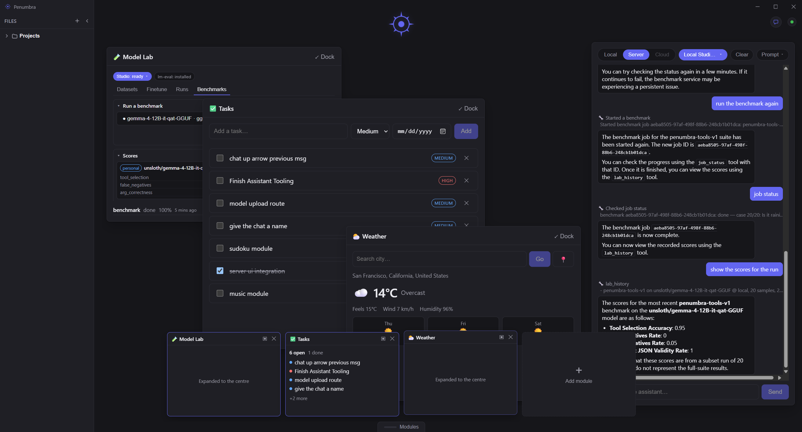

# Penumbra

A local-first personal assistant. Every device holds a full database, works with
no network, and syncs when it reconnects. The assistant runs on a small model
bundled with the desktop app, or on a larger one through your own server.



## Modules

| Module | What it does | Needs |
|---|---|---|
| **Tasks** | Priorities, due dates, done state. Synced across devices. | Nothing |
| **Assistant** | Tool-calling chat over your data, on the embedded model or your server. | Nothing (embedded), a server for Tier 1 |
| **Weather** | Current conditions and a three-day forecast, also an agent tool. | Network |
| **Model Lab** | Fine-tune, export, and benchmark models on a GPU host you run. | A server plus Unsloth Studio |
| **Paint** | MS Paint style drawing with undo, PNG save, copy/paste, and a screen color picker. | Nothing (screen sampling needs the desktop app or a Chromium browser) |

Modules open as windows on the desk: drag, snap, dock, or collapse the desk down
to just the assistant. `Ctrl`/`Cmd` `+`/`-`/`0` scales the UI.

## How it works

```
   Web (browser)                    Desktop (Tauri)
   sqlite-wasm on OPFS,             native SQLite in Rust, plus a
   in a worker                      bundled llama-server sidecar
          │                                  │
          └────────────────┬─────────────────┘
                           │   REST delta sync, last-write-wins
                           ▼
                  Penumbra server  (Fastify + better-sqlite3)
                  sync · agent turns · Model Lab jobs · device tokens
                           │
                           ▼
          chat: model gateway (optional), falling back to Studio
          Unsloth Studio targets: local | colab, for chat and benchmarks
```

Each client reads and writes its own SQLite database; the server only
reconciles. See [ARCHITECTURE.md](docs/ARCHITECTURE.md).

## Running it

Node 20+ and pnpm 9+ (`corepack enable` picks up the pinned version). The desktop
app also needs a stable Rust toolchain and the platform webview.

```bash
pnpm install
```

Web on `:5173` and server on `:3000`:

```bash
pnpm dev
```

Either half alone:

```bash
pnpm --filter @penumbra/web dev
pnpm --filter @penumbra/server dev
```

Desktop app with hot reload:

```bash
pnpm desktop
```

The embedded assistant needs its weights (Qwen3-1.7B Q4_K_M, about 1.3 GB) and
`llama-server` fetched once, or it reports the model offline
([SIDECAR.md](apps/desktop/SIDECAR.md)):

```bash
pnpm fetch-assets
```

`pnpm desktop:build` makes a native package. `bundle.targets` in
`apps/desktop/src-tauri/tauri.conf.json` is pinned to `["deb"]`; widen it for
other platforms.

To use a server on another machine, enter its address in the status pill top
right. To change the build-time default, set `VITE_SERVER_URL` in
`apps/web/.env` (see `.env.example`).

### Configuration

Server settings go in `apps/server/.env` (see `.env.example`). None are required
to run locally.

| Variable | Default | What it does |
|---|---|---|
| `PORT` | `3000` | HTTP port. |
| `DB_PATH` | `server.db` | SQLite file. |
| `UNSLOTH_BASE_URL` / `UNSLOTH_API_KEY` | `http://127.0.0.1:8888` / none | The local Studio's address and bearer. Values set in the compute panel outrank these. |
| `UNSLOTH_MODEL` | `unsloth` | Model id sent in Tier 1 chat requests. Studio ignores it and serves whatever is loaded. |
| `PENUMBRA_GATEWAY_URL` / `_MODEL` / `_KEY` / `_LABEL` | none / none / none / `Gateway` | An OpenAI-compatible gateway (e.g. GoModel). With URL and model set, chat tries it first and falls back to Studio. |
| `UNSLOTH_LAUNCH_CMD` / `UNSLOTH_STOP_CMD` | `unsloth studio` / `unsloth studio stop` | What the panel's Launch and Stop buttons run. Empty hides the button. |
| `LM_EVAL_BIN` | `lm_eval` | The lm_eval executable, e.g. inside a venv. |
| `BENCHMARK_STALL_MS` | `300000` | How long a benchmark may print nothing before it is killed. |
| `PENUMBRA_AGENT_TOKEN` | none | Shared-secret bearer for the gated routes. |
| `PENUMBRA_ALLOWED_ORIGINS` | app origins only | Extra browser origins allowed to call the server. |
| `PENUMBRA_TRUST_PROXY` | off | The reverse proxy in front, if any. Required behind one: see below. |
| `PENUMBRA_UPLOAD_DIR` | `~/.penumbra/uploads` | Where uploaded models and datasets land. |

## Access control

`/sync/tasks` has no auth: run the server on localhost or a trusted LAN.
`/agent/*`, `/lab/*`, and `/compute/*` run models with write tools, spawn jobs,
and write files, so they are gated.

They accept a **per-device token** (add one from the Devices section of the
status pill on the server's own machine; revocable one at a time) or the shared
`PENUMBRA_AGENT_TOKEN`. With neither set they serve loopback only. Behind a
reverse proxy every request looks like loopback, so set `PENUMBRA_TRUST_PROXY`
there or anyone who can reach the proxy can enrol a device.

## Docs

- [ARCHITECTURE.md](docs/ARCHITECTURE.md): layout, data planes, security.
- [SYNC.md](docs/SYNC.md): delta sync and its traps.
- [AGENT_DESIGN.md](docs/AGENT_DESIGN.md): model tiers, the engine seam, small-model limits.
- [MODEL_LAB.md](docs/MODEL_LAB.md): fine-tuning, export, benchmarking, compute targets.
- [EVAL.md](docs/EVAL.md): the tool-calling eval and benchmark suites.

## License

Apache 2.0. See [LICENSE](LICENSE).
